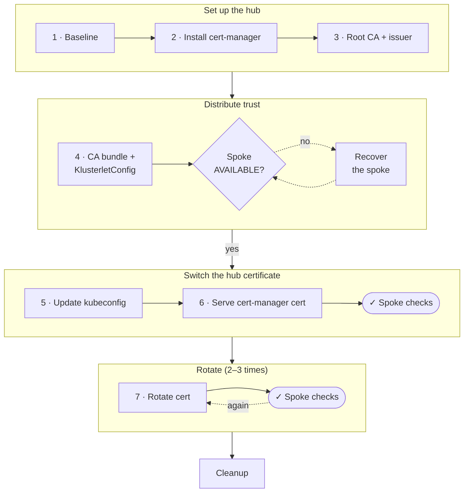

# Scenario C: hub-to-spoke communication across hub certificate rotation

This scenario checks that RHACM managed spokes stay connected when
[cert-manager](https://cert-manager.io/docs/) issues and rotates the hub API
server certificate. It tests the hub-spoke trust configuration from
[telco-reference PR #1027](https://github.com/openshift-kni/telco-reference/pull/1027)
([OCPBUGS-85774](https://issues.redhat.com/browse/OCPBUGS-85774)), part of the
[CNF-21564](https://issues.redhat.com/browse/CNF-21564) acceptance criteria:
"Hub-spoke communication maintained through hub certificate rotation via
KlusterletConfig".

## Why the KlusterletConfig matters

By default (`UseAutoDetectedCABundle`), ACM puts the CA bundle it detects from
the hub API server certificate secret into each spoke's klusterlet bootstrap
kubeconfig. cert-manager stores only the leaf and any intermediate in that
secret, not the root. Spokes then trust the leaf or intermediate instead of the
root, and a certificate change can disconnect them.

The [`KlusterletConfig`](https://docs.redhat.com/en/documentation/red_hat_advanced_cluster_management_for_kubernetes/2.15/html-single/clusters/index#set-hub-kube-api-server)
with `serverVerificationStrategy: UseCustomCABundles` gives the spokes the root
CA (`CA:TRUE`) instead. Any certificate signed by that root, current or renewed,
is trusted with no intervention. The custom bundle replaces the auto-detected
CA rather than adding to it, so on an existing spoke it must also include the
CA of the certificate the hub serves today (see
[Step 4](#step-4-distribute-the-root-ca-to-the-spoke)).

## Test inputs

| Input | Value |
|-------|-------|
| cert-manager Operator | `cert-manager-operator.v1.20.1` from the `redhat-operators` catalog (released; no test images needed) |
| KlusterletConfig and CA ConfigMap | From [PR #1027](https://github.com/openshift-kni/telco-reference/pull/1027); copied into [manifests/hub-klusterletconfig.yaml](../manifests/hub-klusterletconfig.yaml) here |
| Issuer | A self-signed root CA with a CA `ClusterIssuer`, so the test needs no external ACME server |
| Validated on | OCP 4.22 SNO hub with ACM/MCE 2.17.3 and an OCP 4.22 multi-node spoke (November 2026); earlier runs on OCP 4.21 hubs with ACM 2.13 ([earlier validation report](https://gist.github.com/sebrandon1/bba27f3e662c16e62fb552ea24c90d02)) |

> **Validation status:** this guide was run end to end on 2026-11-03 against an
> OCP 4.22 hub (ACM 2.17.3) and a 4.22 spoke. The run covered every step:
> both rotation methods, all spoke checks, and Cleanup. The spoke stayed
> `AVAILABLE=True` with no x509 errors through the certificate switch and both
> rotations. Report any step that does not behave as described.

The telco reference uses an ACME `ClusterIssuer`. The trust mechanism is the
same for any issuer. The only change is which root CA PEM goes into the
ConfigMap: for an ACME issuer, use the root of the ACME server's chain.

## Prerequisites

- A hub cluster with RHACM 2.11 or later (`serverVerificationStrategy` was added
  in 2.11).
- At least one managed spoke showing `JOINED=True` and `AVAILABLE=True`. The
  [optional ZTP setup guide](ztp-hub-spoke-setup.md) can provision one.
- Cluster-admin kubeconfigs for both the hub and the spoke.
- `oc`, `openssl`, and `envsubst`.
- Optional: [`cmctl`](https://cert-manager.io/docs/reference/cmctl/) to trigger
  renewal (`brew install cmctl`, `go install github.com/cert-manager/cmctl/v2@latest`,
  or download a [release](https://github.com/cert-manager/cmctl/releases)).
  Without it, use the secret-deletion method in
  [Step 7](#step-7-trigger-certificate-rotation).

Set the environment for the rest of the guide. Every command runs against the
hub unless it passes `--kubeconfig "$SPOKE_KUBECONFIG"`.

```bash
export HUB_KUBECONFIG="/path/to/hub-kubeconfig"
export SPOKE_KUBECONFIG="/path/to/spoke-kubeconfig"
export SPOKE_NAME="my-spoke"   # ManagedCluster name on the hub

export KUBECONFIG="$HUB_KUBECONFIG"
export HUB_API_HOST="$(oc whoami --show-server | sed -E 's#https://([^:/]+).*#\1#')"
echo "$HUB_API_HOST"

# Print fields of the certificate the hub API is serving right now.
hub_served_cert() {
  echo | openssl s_client -connect "$HUB_API_HOST:6443" -servername "$HUB_API_HOST" 2>/dev/null \
    | openssl x509 -noout "$@"
}

# Poll the served certificate (every 20s, up to 30 minutes) until its issuer
# or serial contains the given text. Works while the API is restarting.
wait_for_served_cert() {
  for _ in $(seq 1 90); do
    if hub_served_cert -issuer -serial 2>/dev/null | grep -qiF "$1"; then
      hub_served_cert -subject -issuer -serial -enddate
      return 0
    fi
    sleep 20
  done
  echo "timed out waiting for served certificate matching: $1" >&2
  return 1
}

# Print the subject of every certificate in a PEM bundle read from stdin.
# (openssl x509 alone prints only the first certificate.)
pem_subjects() {
  openssl crl2pkcs7 -nocrl -certfile /dev/stdin | openssl pkcs7 -print_certs -noout | grep subject
}

# CA bundle in the bootstrap kubeconfig the hub sends to the spoke.
hub_bootstrap_ca() {
  oc -n "$SPOKE_NAME" get manifestwork "$SPOKE_NAME-klusterlet" \
    -o jsonpath='{.spec.workload.manifests[?(@.metadata.name=="bootstrap-hub-kubeconfig")].data.kubeconfig}' \
    | base64 -d | awk '/certificate-authority-data/ {print $2}' | base64 -d
}

# CA bundle in the bootstrap kubeconfig the spoke actually has.
spoke_bootstrap_ca() {
  oc --kubeconfig "$SPOKE_KUBECONFIG" -n open-cluster-management-agent \
    get secret bootstrap-hub-kubeconfig -o jsonpath='{.data.kubeconfig}' \
    | base64 -d | awk '/certificate-authority-data/ {print $2}' | base64 -d
}

oc get managedcluster "$SPOKE_NAME"
oc -n multicluster-engine get deploy managedcluster-import-controller-v2
```

The steps below follow the brownfield order from PR #1027: distribute the root
CA to the spoke **before** the hub starts serving a cert-manager certificate.
Keep the hub's current OpenShift CA in the bundle alongside it.

## Flow overview

The two pass/fail points are the
[spoke communication checks](#spoke-communication-checks) after Step 6 and
after each rotation in Step 7. If a check fails, see
[Troubleshooting](#troubleshooting).



## Step 1: Record the baseline

Capture the certificate the hub API serves now and the spoke's current health:

```bash
hub_served_cert -subject -issuer -serial -enddate | tee "$HOME/hub-api-cert.baseline"

oc get managedcluster "$SPOKE_NAME"
oc -n "$SPOKE_NAME" get managedclusteraddons
oc -n "$SPOKE_NAME" get lease managed-cluster-lease -o jsonpath='{.spec.renewTime}{"\n"}'
```

## Step 2: Install cert-manager on the hub

Create the operator namespace and OperatorGroup, then reuse the pinned
subscription and `CertManager` CR from Scenario A:

```bash
oc apply -f https://raw.githubusercontent.com/sebrandon1/cert-manager-poc/main/manifests/hub-cert-manager-namespace.yaml
oc apply -f https://raw.githubusercontent.com/sebrandon1/cert-manager-poc/main/manifests/subscription-cert-manager.yaml
oc -n cert-manager-operator get installplan
```

Approve the InstallPlan for `cert-manager-operator.v1.20.1` and create the
operand, the same way as
[Scenario A Step 3](../README.md#step-3-install-the-red-hat-cert-manager-operator):

```bash
oc -n cert-manager-operator patch installplan <installplan-name> \
  --type merge -p '{"spec":{"approved":true}}'
oc -n cert-manager-operator wait --for=jsonpath='{.status.phase}'=Succeeded \
  csv/cert-manager-operator.v1.20.1 --timeout=5m

oc apply -f https://raw.githubusercontent.com/sebrandon1/cert-manager-poc/main/manifests/cert-manager-cr.yaml
oc -n cert-manager rollout status deploy/cert-manager
oc -n cert-manager rollout status deploy/cert-manager-webhook
oc -n cert-manager rollout status deploy/cert-manager-cainjector
```

## Step 3: Create the root CA and issuer

The [root CA manifest](../manifests/hub-root-ca-issuer.yaml) creates a
self-signed root CA (`CN=hub-root-ca`) and a CA `ClusterIssuer` named
`hub-root-ca-issuer` that signs with it:

```bash
oc apply -f https://raw.githubusercontent.com/sebrandon1/cert-manager-poc/main/manifests/hub-root-ca-issuer.yaml
oc -n cert-manager wait --for=condition=Ready certificate/hub-root-ca --timeout=2m
oc wait --for=condition=Ready clusterissuer/hub-root-ca-issuer --timeout=2m

oc -n cert-manager get secret hub-root-ca -o jsonpath='{.data.ca\.crt}' | base64 -d > "$HOME/hub-root-ca.pem"
openssl x509 -in "$HOME/hub-root-ca.pem" -noout -subject -ext basicConstraints
```

The output should show `subject=CN=hub-root-ca` and `CA:TRUE`.

## Step 4: Distribute the root CA to the spoke

With `UseCustomCABundles`, the ConfigMap's bundle **replaces** the CA in the
spoke's bootstrap kubeconfig. It is not added to the CA the spoke already
trusts. The klusterlet agent restarts when its bootstrap kubeconfig changes,
and from then on trusts only what is in the bundle. The hub is still serving
its OpenShift-managed certificate at this point. A bundle holding only
`hub-root-ca` would therefore disconnect the spoke with
`x509: certificate signed by unknown authority`.

So build the bundle from the root CA **plus** the OpenShift API serving CAs
the hub uses today. The spoke then trusts both the current certificate and the
cert-manager one:

```bash
oc -n openshift-kube-apiserver get configmap kube-apiserver-server-ca \
  -o jsonpath='{.data.ca-bundle\.crt}' > "$HOME/ocp-api-server-ca.pem"
cat "$HOME/hub-root-ca.pem" "$HOME/ocp-api-server-ca.pem" > "$HOME/hub-ca-bundle.pem"
pem_subjects < "$HOME/hub-ca-bundle.pem"
```

The output lists `CN=hub-root-ca` and the `kube-apiserver-*-signer` CAs.

Create the CA bundle ConfigMap. The label value must be the string `"true"`;
the import controller ignores an empty value.

```bash
oc -n multicluster-engine create configmap cert-manager-hub-ca-bundle \
  --from-file=ca-bundle.crt="$HOME/hub-ca-bundle.pem" \
  --dry-run=client -o yaml | oc apply -f -
oc -n multicluster-engine label configmap cert-manager-hub-ca-bundle \
  import.open-cluster-management.io/ca-bundle=true --overwrite
```

Apply the [KlusterletConfig](../manifests/hub-klusterletconfig.yaml) and attach
it to the spoke:

```bash
oc apply -f https://raw.githubusercontent.com/sebrandon1/cert-manager-poc/main/manifests/hub-klusterletconfig.yaml
oc annotate managedcluster "$SPOKE_NAME" \
  agent.open-cluster-management.io/klusterlet-config=cert-manager-ca-config --overwrite
```

For a new ZTP spoke, set the annotation through the ClusterInstance instead, as
the example ClusterInstance CRs in PR #1027 show:

```yaml
spec:
  extraAnnotations:
    ManagedCluster:
      agent.open-cluster-management.io/klusterlet-config: "cert-manager-ca-config"
```

The import controller regenerates the bootstrap kubeconfig in the spoke's
klusterlet ManifestWork (`<cluster>-klusterlet` in the cluster's namespace),
usually within a minute. The work agent then applies it on the spoke, and the
klusterlet agent restarts. Check the hub side first, then the spoke side:

```bash
hub_bootstrap_ca | pem_subjects
spoke_bootstrap_ca | pem_subjects
```

**Pass:** both list `CN=hub-root-ca` and the `kube-apiserver-*-signer` CAs.

Optionally confirm in the import controller logs. It runs two replicas and only
one logs the regeneration, so check both:

```bash
for p in $(oc -n multicluster-engine get pod -o name | grep managedcluster-import-controller); do
  oc -n multicluster-engine logs "$p" --since=10m | grep "create a new bootstrap kubeconfig for the managed cluster $SPOKE_NAME"
done
```

Then confirm the spoke reconnected after the agent restart. The lease must be
renewed after the restart:

```bash
oc wait managedcluster "$SPOKE_NAME" \
  --for=condition=ManagedClusterConditionAvailable=True --timeout=10m
oc -n "$SPOKE_NAME" get lease managed-cluster-lease -o jsonpath='{.spec.renewTime}{"\n"}'
oc -n "$SPOKE_NAME" get managedclusteraddons
```

Do not continue until all of this passes. Switching the hub certificate before
the spoke trusts the root CA disconnects the spoke. If the spoke goes
`AVAILABLE=Unknown` here, see
[Recovering a disconnected spoke](#recovering-a-disconnected-spoke).

## Step 5: Keep your hub kubeconfig working

Once the hub API serves a certificate from `hub-root-ca`, the CA in your admin
kubeconfig no longer verifies it and `oc` fails with
`x509: certificate signed by unknown authority`. Back up the kubeconfig and add
the root CA to its trusted CAs before switching:

```bash
cp "$HUB_KUBECONFIG" "$HUB_KUBECONFIG.bak"
HUB_CLUSTER="$(oc config view --minify -o jsonpath='{.clusters[0].name}')"
{
  oc config view --minify --raw -o jsonpath='{.clusters[0].cluster.certificate-authority-data}' | base64 -d
  cat "$HOME/hub-root-ca.pem"
} > "$HOME/hub-kubeconfig-ca.pem"
oc config set "clusters.$HUB_CLUSTER.certificate-authority-data" \
  "$(base64 < "$HOME/hub-kubeconfig-ca.pem" | tr -d '\n')"
oc whoami
```

If your kubeconfig uses `certificate-authority` (a file path) instead of
`certificate-authority-data`, append the root CA to that file instead.

## Step 6: Serve a cert-manager certificate from the hub API

Issue the [hub API certificate](../manifests/hub-api-certificate.yaml) in
`openshift-config`, then point the `APIServer` at it:

```bash
curl -sL https://raw.githubusercontent.com/sebrandon1/cert-manager-poc/main/manifests/hub-api-certificate.yaml \
  | envsubst | oc apply -f -
oc -n openshift-config wait --for=condition=Ready certificate/hub-api-certificate --timeout=2m

oc patch apiserver cluster --type merge -p "{
  \"spec\": {\"servingCerts\": {\"namedCertificates\": [{
    \"names\": [\"$HUB_API_HOST\"],
    \"servingCertificate\": {\"name\": \"hub-api-cert\"}
  }]}}
}"
```

The patch replaces any existing `namedCertificates`. If the hub already has
named certificates, edit the list instead of patching it.

The kube-apiserver rolls out a new revision and the API is briefly
unavailable. On a 4.22 SNO hub the new certificate was served about 2 minutes
after the patch and the rollout finished about a minute later. On a multi-node
hub the masters update one at a time, which takes longer. Wait until the hub serves the new
certificate, then until the rollout finishes:

```bash
wait_for_served_cert hub-root-ca
oc wait co/kube-apiserver --for=condition=Progressing=False --timeout=30m
```

If `oc wait` fails with connection errors while the API restarts, run it
again.

**Pass:** the issuer is `CN=hub-root-ca`. Then run the
[spoke communication checks](#spoke-communication-checks). This is the first
pass/fail point: the spoke must stay connected when the hub switches from the
OpenShift-managed certificate to the cert-manager one.

## Step 7: Trigger certificate rotation

Record the current serial, then force cert-manager to reissue the certificate.

```bash
oc -n openshift-config get secret hub-api-cert -o jsonpath='{.data.tls\.crt}' \
  | base64 -d | openssl x509 -noout -serial | tee "$HOME/hub-api-serial.before"
```

**Option A (preferred): `cmctl renew`.** This marks the `Certificate` for
reissuance through the normal renewal path, the same as an expiry-driven
renewal:

```bash
cmctl renew hub-api-certificate -n openshift-config
```

**Option B: delete the secret.** cert-manager notices the missing secret and
reissues it. The earlier validation used this method:

```bash
oc -n openshift-config delete secret hub-api-cert
```

Both options create a new private key, because the certificate sets
`rotationPolicy: Always`. Wait for the reissue, then for the hub to serve the
new serial:

```bash
oc -n openshift-config wait --for=condition=Ready certificate/hub-api-certificate --timeout=5m
oc -n openshift-config get certificaterequests
oc -n openshift-config get secret hub-api-cert -o jsonpath='{.data.tls\.crt}' \
  | base64 -d | openssl x509 -noout -serial | tee "$HOME/hub-api-serial.after"
if cmp -s "$HOME/hub-api-serial.before" "$HOME/hub-api-serial.after"; then
  echo "FAIL: serial did not change"
else
  echo "serial changed"
fi

wait_for_served_cert "$(cut -d= -f2 "$HOME/hub-api-serial.after")"
oc get co kube-apiserver
```

Unlike Step 6, a rotation does not roll out a new kube-apiserver revision. The
kube-apiserver reloads the changed secret in place, and on the 4.22 test hub
the new serial was served within about 15 seconds of issuance, with no API
outage. `kube-apiserver` should stay `AVAILABLE=True`, `PROGRESSING=False`.

**Pass:** the hub serves the serial in `hub-api-serial.after`. Run the
[spoke communication checks](#spoke-communication-checks) again. This is the
second pass/fail point.

Repeat Step 7 two or three times to confirm the result holds across
consecutive rotations.

To exercise expiry-driven renewal instead, set `spec.duration: 1h` and
`spec.renewBefore: 30m` on the certificate. cert-manager then renews it every
30 minutes, and the kube-apiserver picks up each new certificate.

## Spoke communication checks

Run all of these after Step 6 and after each rotation in Step 7.

**1. ManagedCluster health (hub).** `JOINED` and `AVAILABLE` must both be
`True`:

```bash
oc get managedcluster "$SPOKE_NAME"
oc wait managedcluster "$SPOKE_NAME" \
  --for=condition=ManagedClusterConditionAvailable=True --timeout=10m
```

**2. Lease renewal (hub).** The spoke's registration agent renews this lease
about once a minute. Run the command twice, a minute or more apart; the
timestamp must advance:

```bash
oc -n "$SPOKE_NAME" get lease managed-cluster-lease -o jsonpath='{.spec.renewTime}{"\n"}'
```

**3. Add-on health (hub).** Every add-on must report `AVAILABLE=True`:

```bash
oc -n "$SPOKE_NAME" get managedclusteraddons
```

**4. ManifestWork round trip (hub to spoke).** This proves the hub can deliver
new work to the spoke after the rotation. The
[probe manifest](../manifests/spoke-connectivity-manifestwork.yaml) creates a
ConfigMap on the spoke:

```bash
export PROBE_ID="$(date +%s)"
curl -sL https://raw.githubusercontent.com/sebrandon1/cert-manager-poc/main/manifests/spoke-connectivity-manifestwork.yaml \
  | envsubst | oc apply -f -
oc -n "$SPOKE_NAME" wait manifestwork/cert-rotation-probe --for=condition=Available --timeout=5m
oc --kubeconfig "$SPOKE_KUBECONFIG" -n default get configmap cert-rotation-probe \
  -o jsonpath='{.data.probe}{"\n"}'
echo "expected: $PROBE_ID"
oc -n "$SPOKE_NAME" delete manifestwork cert-rotation-probe
```

**5. No TLS errors in the klusterlet (spoke).** Check every pod in the agent
namespace. The agent deployment runs several replicas, and
`oc logs deploy/...` reads only one of them, which may not be the leader:

```bash
for p in $(oc --kubeconfig "$SPOKE_KUBECONFIG" -n open-cluster-management-agent get pod -o name); do
  echo "== $p"
  oc --kubeconfig "$SPOKE_KUBECONFIG" -n open-cluster-management-agent logs "$p" \
    --all-containers --since=15m | grep -iE 'x509|unknown authority|tls: ' || echo "no TLS errors"
done
```

A short burst of connection-refused errors during the kube-apiserver rollout is
expected. `x509: certificate signed by unknown authority` is a failure.

**6. Bootstrap trust unchanged (hub and spoke).** Both bootstrap kubeconfigs
should still carry the bundle from Step 4, unchanged by the rotation:

```bash
hub_bootstrap_ca | pem_subjects
spoke_bootstrap_ca | pem_subjects
```

### Pass criteria

| Check | Expected |
|-------|----------|
| Bootstrap kubeconfig CA, hub and spoke (Step 4, check 6) | `CN=hub-root-ca` plus the `kube-apiserver-*-signer` CAs |
| Served hub API certificate (Steps 6–7) | Issuer `CN=hub-root-ca`; new serial after each rotation |
| ManagedCluster | `JOINED=True`, `AVAILABLE=True` within 10 minutes of each rollout finishing |
| Lease | `renewTime` advances |
| Add-ons | All `AVAILABLE=True` |
| ManifestWork probe | `Available`; ConfigMap on spoke holds the current `PROBE_ID` |
| Klusterlet logs | No `x509` / `unknown authority` errors |
| Manual intervention | None: no re-import and no ManifestWork edits |

## Cleanup

Restore the hub to its OpenShift-managed API certificate without disconnecting
the spoke. The spoke still trusts the OpenShift API serving CAs from the Step 4
bundle. Confirm that before reverting:

```bash
spoke_bootstrap_ca | pem_subjects
```

If the output lists only `CN=hub-root-ca` (for example, because the bundle was
narrowed to the root CA after Step 6), rebuild the combined bundle as in
Step 4 and wait for the spoke to pick it up before continuing.

Revert the API server and wait for the rollout:

```bash
oc patch apiserver cluster --type json -p '[{"op":"remove","path":"/spec/servingCerts/namedCertificates"}]'
wait_for_served_cert "$(sed -n 's/^issuer=//p' "$HOME/hub-api-cert.baseline")"
oc wait co/kube-apiserver --for=condition=Progressing=False --timeout=30m
cp "$HUB_KUBECONFIG.bak" "$HUB_KUBECONFIG"
oc get managedcluster "$SPOKE_NAME"
```

Once the spoke is `AVAILABLE=True`, remove the test resources. cert-manager
does not delete a certificate's secret when the `Certificate` is deleted, so
delete the secrets explicitly:

```bash
oc annotate managedcluster "$SPOKE_NAME" agent.open-cluster-management.io/klusterlet-config-
oc delete klusterletconfig cert-manager-ca-config
oc -n multicluster-engine delete configmap cert-manager-hub-ca-bundle
oc -n openshift-config delete certificate hub-api-certificate
oc -n openshift-config delete secret hub-api-cert
oc delete -f https://raw.githubusercontent.com/sebrandon1/cert-manager-poc/main/manifests/hub-root-ca-issuer.yaml
oc -n cert-manager delete secret hub-root-ca
```

Removing the annotation puts the spoke back on the auto-detected CA bundle.
The klusterlet agent restarts once more. Confirm the spoke reconnects:

```bash
spoke_bootstrap_ca | pem_subjects   # kube-apiserver-*-signer CAs, no hub-root-ca
oc wait managedcluster "$SPOKE_NAME" \
  --for=condition=ManagedClusterConditionAvailable=True --timeout=10m
oc -n "$SPOKE_NAME" get managedclusteraddons
```

## Troubleshooting

```bash
# Import controller: did it pick up the ConfigMap and KlusterletConfig?
oc -n multicluster-engine get configmap cert-manager-hub-ca-bundle --show-labels
oc get klusterletconfig cert-manager-ca-config -o yaml
oc get managedcluster "$SPOKE_NAME" -o jsonpath='{.metadata.annotations}{"\n"}'
hub_bootstrap_ca | pem_subjects
# The import controller runs two replicas; check both.
for p in $(oc -n multicluster-engine get pod -o name | grep managedcluster-import-controller); do
  oc -n multicluster-engine logs "$p" --since=30m | grep -i "$SPOKE_NAME"
done

# cert-manager issuance
oc -n openshift-config describe certificate hub-api-certificate
oc -n openshift-config get certificaterequests
oc -n cert-manager logs deploy/cert-manager --since=30m

# kube-apiserver rollout
oc get co kube-apiserver
oc get apiserver cluster -o jsonpath='{.spec.servingCerts}{"\n"}'

# Spoke klusterlet status
oc --kubeconfig "$SPOKE_KUBECONFIG" get klusterlet klusterlet -o yaml
oc --kubeconfig "$SPOKE_KUBECONFIG" -n open-cluster-management-agent get pods
```

### Recovering a disconnected spoke

Symptom: `AVAILABLE=Unknown` on the hub, the `managed-cluster-lease` stops
renewing, and the spoke's klusterlet agent logs
`x509: certificate signed by unknown authority`. Compare what the spoke trusts
with what the hub serves:

```bash
spoke_bootstrap_ca | pem_subjects
hub_served_cert -issuer
```

If the served certificate's issuer is missing from the spoke's bundle, the
spoke cannot recover on its own. The hub delivers the bootstrap kubeconfig
through a ManifestWork, and the spoke cannot fetch it while the TLS check
fails. This happens if the Step 4 bundle held only `hub-root-ca`, or if the hub
was switched before the spoke trusted the root CA.

First fix the bundle on the hub, as in Step 4. Then **wait until the hub's
klusterlet ManifestWork carries the fixed bundle**. The output must include the
issuer of the certificate the hub serves (`hub_served_cert -issuer`):

```bash
hub_bootstrap_ca | pem_subjects
```

The import controller can take several minutes to regenerate the ManifestWork
for a disconnected spoke. Do not skip this wait. As soon as the spoke
reconnects, its work agent applies whatever the ManifestWork holds. If that is
still the old bundle, it overwrites the repair and the spoke disconnects again.

Then copy the ManifestWork's bundle into the spoke's bootstrap kubeconfig, and
delete the agent pods so they load it:

```bash
hub_bootstrap_ca > "$HOME/recovery-ca.pem"
oc --kubeconfig "$SPOKE_KUBECONFIG" -n open-cluster-management-agent \
  get secret bootstrap-hub-kubeconfig -o jsonpath='{.data.kubeconfig}' \
  | base64 -d > "$HOME/spoke-bootstrap.kubeconfig"
cp "$HOME/spoke-bootstrap.kubeconfig" "$HOME/spoke-bootstrap.kubeconfig.bak"
BOOT_CLUSTER="$(oc --kubeconfig "$HOME/spoke-bootstrap.kubeconfig" config view -o jsonpath='{.clusters[0].name}')"
oc --kubeconfig "$HOME/spoke-bootstrap.kubeconfig" config set \
  "clusters.$BOOT_CLUSTER.certificate-authority-data" \
  "$(base64 < "$HOME/recovery-ca.pem" | tr -d '\n')"
oc --kubeconfig "$SPOKE_KUBECONFIG" -n open-cluster-management-agent \
  set data secret/bootstrap-hub-kubeconfig --from-file=kubeconfig="$HOME/spoke-bootstrap.kubeconfig"
oc --kubeconfig "$SPOKE_KUBECONFIG" -n open-cluster-management-agent \
  delete pod -l app=klusterlet-agent
oc wait managedcluster "$SPOKE_NAME" \
  --for=condition=ManagedClusterConditionAvailable=True --timeout=10m
```

Run the [spoke communication checks](#spoke-communication-checks) afterwards,
waiting at least two minutes. A spoke that briefly shows `AVAILABLE=True` can
still drop again if the race above happened.

Delete the pods; don't use `oc rollout restart`. The klusterlet operator
reverts the restart annotation on its deployment, so the old pods keep running
with the old CA. Re-importing the spoke also works, but takes longer.
